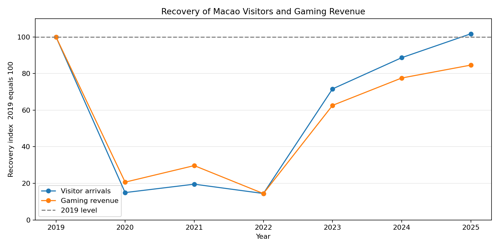

# Assignment 01 · Macao Tourism and Gaming Recovery

**Research question**

How did Macao's annual visitor arrivals and gaming revenue recover relative to 2019?

This CISC7204 Assignment 01 showcase presents the preliminary annual analysis. The notebook uses seven annual records for 2019–2025 and divides each series by its own 2019 value. It uses Python, pandas, and Matplotlib.

In 2025, visitor arrivals reached **101.7%** of the 2019 level, while nominal gaming revenue reached **84.6%**. Annual totals conceal differences within a year. The gaming revenue series is nominal, and the comparison is descriptive.

The original notebook embeds annual visitor arrivals and gaming revenue, in MOP million, from public Macao statistics. The [source and permissions record](https://github.com/Bewicksun/data-science-project/blob/main/SOURCES.md#annual-background-data) identifies the DSEC, Macao Yearbook, and DICJ references used to check the figures. The Assignment 01 notebook retains its original rounded 2025 gaming revenue of MOP 247,400 million. The later source check used MOP 247,404 million. Both give the same recovery index to one decimal place. Usage conditions are documented in the [project source record](https://github.com/Bewicksun/data-science-project/blob/main/SOURCES.md#usage-permissions).

## Reproduce the analysis

From this directory, install the packages with `python -m pip install -r requirements.txt`. Install JupyterLab with `python -m pip install jupyterlab`, then start it with `python -m jupyterlab` and run all cells in [analysis.ipynb](analysis.ipynb). Input values are embedded in the notebook.

[Assignment 02 extends this analysis with corresponding-month baselines and monthly gap comparisons](https://github.com/Bewicksun/data-science-project).
